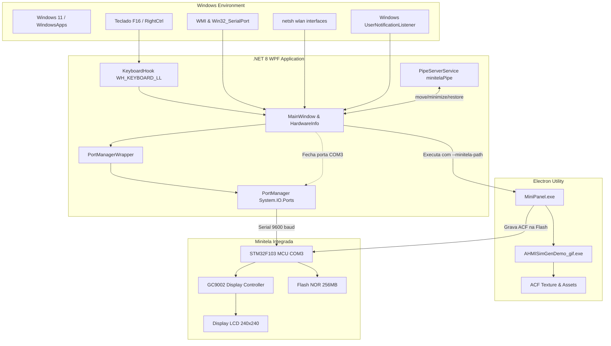

# Engenharia Reversa da Aplicação Positivo MiniTelaApp e Controle do Hardware Integrado

## 1. Visão Geral e Identificação do Hardware

A análise estática e dinâmica realizada através do **REA** (*Reverse Engineer Anything*) e inspeção de metadados CIL/PE e pacotes ASAR revelou a arquitetura completa de controle da minitela integrada presente no notebook Positivo.

### 1.1. Especificações Físicas do Dispositivo
* **Resolução Nativa da Tela:** $240 \times 240$ pixels (`width: 240`, `height: 240`).
* **Controlador Gráfico (Display Driver):** GC9002 (com suporte a modos GC9003/GC9005 na stack de compilação).
* **Microcontrolador da Placa (MCU):** **STM32F103** da STMicroelectronics (`PCB12.3_V2`).
* **Memória da Tela:** Flash NOR de 256 MB para armazenamento permanente de layouts, fontes e texturas compiladas (`.acf`).
* **Suporte a Toque Físico:** Desabilitado (`supportTouch: false`). A tela não possui touchscreen capacitivo/resistivo; a alternância de telas e interações ocorre via software e atalho de hardware no teclado.
* **Interface de Barramento e Comunicação:**
  * **Barramento:** USB Interno (USB Composite Device).
  * **Hardware ID:** `USB\VID_0324&PID_0324` (Serial: `2022123456`).
  * **Interface Serial (CDC):** `USB\VID_0324&PID_0324&MI_00` vinculada à porta **`COM3`**.
  * **Taxa de Transmissão (Baud Rate):** `9600 baud` para envio de comandos de telemetria e troca de telas (e até `115200 baud` no utilitário de gravação de firmware).
  * **Parâmetros Seriais:** 8 bits de dados, sem paridade, 1 stop bit (`8-N-1`).

---

## 2. Arquitetura de Software

O ecossistema do software Positivo MiniTela é composto por duas aplicações integradas:



### 2.1. MiniTelaApp (.NET 8 WPF)
* **Localização:** `C:\Program Files\WindowsApps\PositivoInformticaS.A.PositivoMinitela_1.0.43.0_x64__6yhrh9dmgepzj\MiniTelaApp\MiniTelaApp.dll`
* **Tecnologia:** .NET 8 (CoreCLR), x86/x64 CIL puro gerenciado.
* **Responsabilidades:**
  1. **Detecção Dinâmica da Porta:** Executa a consulta WMI `SELECT * FROM Win32_SerialPort` e localiza a porta cujo `PNPDeviceID` contém `USB\VID_0324&PID_0324&MI_00` (caso não encontre, adota fallback para `COM3`).
  2. **Ciclo de Atualização em Tempo Real:** Coleta bateria (WMI), intensidade de sinal Wi-Fi e SSID (`netsh.exe wlan show interfaces`), status Bluetooth (WinRT), data/hora do sistema, previsão do tempo (via JSON local/remoto) e notificações do WhatsApp Desktop via `Windows.UI.Notifications.Management.UserNotificationListener`.
  3. **Hook Global de Teclado:** Utiliza a API Win32 `SetWindowsHookEx` (`WH_KEYBOARD_LL`) para interceptar teclas específicas:
     * **Teclas Monitoradas:** Virtual Key `105` (`Key.F16`) ou Virtual Key `119` (`Key.RightCtrl`).
     * **Toque Rápido (< 300 ms):** Dispara `FastReleaseDetected`, avançando ciclicamente para a próxima tela no display integrado (`ChangeScreen`).
     * **Toque Longo (Pressionar e Manter $\ge$ 500 ms):** Dispara `HoldTimeReached`, restaurando, centralizando e trazendo a janela de configuração do MiniTelaApp para o primeiro plano no Windows (`Activate` e `Focus`).
  4. **Servidor IPC (Named Pipe):** Mantém um servidor no pipe `\\.\pipe\minitelaPipe` que responde aos comandos `status`, `minimize`, `restore` e `move:X:Y` (para posicionar o app em coordenadas de monitores secundários).

### 2.2. MiniPanel (Electron + Edge.js)
* **Localização:** `MiniTelaApp\assets\minipanel\MiniPanel.exe`
* **Tecnologia:** Electron empacotado (`app.asar`), React e `electron-edge-js`.
* **Papel no Sistema:** Quando o usuário clica para customizar GIFs ou novas imagens na minitela:
  1. `MiniTelaApp` fecha a porta serial (`PortManager.Close()`) para evitar conflito de acesso concorrente ao dispositivo.
  2. Executa `MiniPanel.exe --minitela-path="C:\...\Minitela"`.
  3. `MiniPanel` utiliza utilitários nativos em C/C++ (`AHMISimGenDemo_gif.exe` / `AHMISimGenDemo_og.exe`) localizados em `IDE_utils_pt\Gen\` para processar frames, comprimir paletas e gerar os arquivos binários de textura `.acf` (`ConfigData&Texture.acf`).
  4. O arquivo `.acf` gerado é transmitido e gravado na memória flash NOR do hardware via protocolo de download AHMI (`REQUEST_DOWNLOAD` -> `DOWNLOAD_DATA` -> `DOWNLOAD_COMPLETE`).

---

## 3. Protocolo de Comunicação Serial (AHMI Protocol)

A comunicação com a minitela segue o protocolo binário da plataforma de displays inteligentes **AHMI (AHMI Smart Display / USART HMI)**.

### 3.1. Estrutura do Quadro (Frame)

| Campo | Tamanho | Valor / Formato | Descrição |
| :--- | :--- | :--- | :--- |
| **Start Flag** | 2 bytes | `0x41 0x48` (`"AH"`) | Delimitador de início do quadro |
| **Control Flag** | 2 bytes | Big-Endian UInt16 | Tamanho do pacote + bit 15 (`0x80`) para indicar CRC habilitado |
| **Command Type** | 2 bytes | Big-Endian UInt16 | Identificador do comando (ex: `0x0090` para Set Register) |
| **Payload Content** | N bytes | Binário variável | Dados específicos do comando e registrador |
| **CRC16** | 2 bytes | Big-Endian UInt16 | Checksum CRC-16 de `[ControlFlag + CommandType + Content]` |
| **End Flag** | 2 bytes | `0x4D 0x49` (`"MI"`) | Delimitador de fim do quadro |

### 3.2. Tipos de Comandos (CommandType)

```typescript
enum CommandType {
    HANDSHAKE                    = 0x0080, // Resposta: 0x00C0
    REQUEST_DOWNLOAD             = 0x0081, // Resposta: 0x00C1 (Gravação de Flash)
    DOWNLOAD_DATA                = 0x0082, // Resposta: 0x00C2
    UPLOAD_DATA                  = 0x0083, // Resposta: 0x00C3
    GET_DOWNLOAD_STATUS          = 0x0085, // Resposta: 0x00C5
    GET_OFFSET                   = 0x0086, // Resposta: 0x00C6
    DOWNLOAD_COMPLETE            = 0x008F, // Resposta: 0x00CF
    REBOOT                       = 0x0070, // Resposta: 0x00B0
    SWITCH_STATE                 = 0x0071, // Resposta: 0x00B1
    SET_REGISTER                 = 0x0090, // Resposta: 0x00D0 (Atualização de dados da tela)
}
```

---

## 4. Dissecção dos Pacotes do `SET_REGISTER` (0x0090)

No dia a dia, 100% da interação da aplicação ocorre por meio do comando `SET_REGISTER` (`0x0090`), manipulando registradores da memória da tela.

### 4.1. Pacote de Atualização Numérica (`UpdateNum`) - 17 Bytes
Utilizado para alternar telas, ajustar brilho, atualizar porcentagem da bateria e ícones.

```
+-------+---------------+---------------+---------------+-----------+---------------+-------+
|  AH   |  Control Flag |  Command Type |   Flags/Sub   |  Reg ID   | 32-bit Value  |  CRC  |  MI   |
| 41 48 |     80 09     |     00 90     |      80       |  00 [ID]  | [V3 V2 V1 V0] | E2 CB | 4D 49 |
+-------+---------------+---------------+---------------+-----------+---------------+-------+
```

* **Bytes 0..1:** `41 48` (`"AH"`)
* **Bytes 2..3:** `80 09` (Tamanho = 9 bytes de payload + CRC habilitado)
* **Bytes 4..5:** `00 90` (`SET_REGISTER`)
* **Byte 6:** `80` (Flag de escrita no registrador)
* **Bytes 7..8:** Registrador de Destino (16-bit Big-Endian)
* **Bytes 9..12:** Valor Inteiro (32-bit Big-Endian)
* **Bytes 13..14:** Checksum CRC-16
* **Bytes 15..16:** `4D 49` (`"MI"`)

#### Exemplos Reais Extraídos do Código:
1. **Trocar Tela Ativa (`ChangeScreen`):**
   * Registrador: `0x0002` (Reg 2).
   * Byte 12: Número da Tela (`1` a `6`).
   * Pacote: `41 48 80 09 00 90 80 00 02 00 00 00 [TELA] E2 CB 4D 49`

2. **Ajustar Brilho da Tela (`BrightnessValue`):**
   * Registrador: `0x0007` (Reg 7).
   * Byte 12: Nível de Brilho (`0` a `100`).
   * Pacote: `41 48 80 09 00 90 80 00 07 00 00 00 [BRILHO] E2 CB 4D 49`

### 4.2. Pacote de Atualização de Texto (`PrepareStringToBuffer`)
Utilizado para enviar strings (SSID do Wi-Fi, nome da cidade, temperatura, notas e mensagens do WhatsApp).

1. **Subpacote Interno (Payload):**
   * `0x00, 0x90, 0xD0`
   * 2 bytes: `Register ID` (Big-Endian)
   * 2 bytes: `String Length` (Big-Endian)
   * N bytes: String codificada em **UTF-8**
   * 4 bytes de Trailer Interno: `0xE2, 0xCB, 0x4D, 0x49`
2. **Encapsulamento Externo:**
   * Prefixado com cabeçalho `"AH"` (`0x41 0x48`) e o comprimento total do bloco.

---

## 5. Tabela Completa de Registradores de Hardware (`indexOfRegister`)

A tabela a seguir foi mapeada diretamente da especificação gráfica `data.json` da tela e das rotinas em CIL de `MiniTelaApp.dll`:

| Registrador | Nome no Hardware | Tipo de Dado | Função e Descrição |
| :---: | :--- | :--- | :--- |
| **2** | `Screen_Select` | UInt32 (1-6) | **Seletor de Página:** Define qual das 6 telas do display está visível no momento. |
| **7** | `Backlight_Brightness` | UInt32 (0-100) | **Brilho da Tela:** Controla a iluminação traseira (PWM do backlight). |
| **1082** | `Battery_Percent` | String / UInt32 | **Porcentagem da Bateria:** Texto ex: `"85%"` e valor numérico `85`. |
| **1083** | `Wifi_SSID` | String UTF-8 | **Nome da Rede Wi-Fi:** SSID conectado ou `"Desconectado"`. |
| **1085** | `BT_Name` | String UTF-8 | **Bluetooth:** Nome do dispositivo pareado ou status. |
| **1090** | `Reminder1` | String UTF-8 | **Nota/Tarefa 1:** 14 chars/linha, até 8 linhas (máximo 90 chars). |
| **1092** | `Reminder2` | String UTF-8 | **Nota/Tarefa 2:** Segunda tarefa configurada pelo usuário. |
| **1094** | `Reminder3` | String UTF-8 | **Nota/Tarefa 3:** Terceira tarefa configurada pelo usuário. |
| **1110** | `Weather_1_Type` | UInt32 | **Ícone do Clima Hoje:** Índice numérico do ícone meteorológico atual. |
| **1115** | `Weather_2_Type` | UInt32 | **Ícone do Clima Amanhã:** Índice numérico do ícone para o dia seguinte. |
| **1119** | `Weather_2_Temp_Desc`| String UTF-8 | **Data de Amanhã:** Abreviação do dia ex: `"SEX 13"`. |
| **1120** | `Weather_3_Type` | UInt32 | **Ícone do Clima D+2:** Índice numérico do ícone para depois de amanhã. |
| **1124** | `Weather_3_Temp_Desc`| String UTF-8 | **Data de D+2:** Abreviação do dia ex: `"SÁB 14"`. |
| **1140** | `notification1Sender`| String UTF-8 | **WhatsApp Remetente:** Nome do contato ou grupo que enviou a mensagem. |
| **1141 / 1143**| `notification_1_content`| String UTF-8 | **WhatsApp Mensagem:** Texto da notificação (13 chars/linha, até 5 linhas, max 90 chars truncado com `...`). |
| **1150** | `Battery_Type` | UInt32 (0-3) | **Ícone da Bateria:** Nível de carga em 4 estágios (`valor / 25`, máx 3). |
| **2005** | `whatsapp_logo` | UInt32 (0 ou 1) | **Indicador WhatsApp:** 1 para ativo/conectado, 0 para oculto/desconectado. |
| **2006** | `dateHour` | String UTF-8 | **Data e Hora:** Atualizado a cada segundo no formato `"dd/MM HH:mm"`. |
| **2007** | `Notification_Dot` | UInt32 (0 ou 1) | **Badge de Notificação:** Sinalizador de nova mensagem não lida. |
| **2025** | `MessageBackground1` | UInt32 | Estilo/visibilidade do balão de notificação 1. |
| **2026** | `MessageBackground2` | UInt32 | Estilo/visibilidade do balão de notificação 2. |
| **2027** | `city` | String UTF-8 | **Cidade Meteorológica:** Nome da cidade configurada no clima. |
| **2030** | `currentTemp` | String UTF-8 | **Temperatura Hoje:** Texto ex: `"19°/28°"`. |
| **2031** | `forecastTemp1` | String UTF-8 | **Temperatura Amanhã:** Texto ex: `"18°/26°"`. |
| **2032** | `forecastTemp2` | String UTF-8 | **Temperatura D+2:** Texto ex: `"20°/31°"`. |

---

## 6. Mapeamento das Telas Gravadas no Hardware (`PageList`)

O firmware gravado na tela NOR Flash possui as seguintes páginas pré-desenhadas:

1. **Page 0 (`WhatsApp`):** Apresenta o remetente, prévia da última mensagem recebida no WhatsApp Desktop e botão de status de conexão.
2. **Page 1 (`Reminder`):** Apresenta até 3 tarefas/anotações rápidas cadastradas pelo usuário no aplicativo.
3. **Page 2 (`SystemInfo`):** Mostra relógio digital, data, percentual e ícone da bateria, rede Wi-Fi e status Bluetooth.
4. **Page 3 (`Weather`):** Mostra a cidade atual, clima de hoje e previsão para os próximos 2 dias com ícones e temperaturas máximas/mínimas.
5. **Page 4 (`Gif1`):** Tela de reprodução de animação GIF customizada 1.
6. **Page 5 (`Gif2`):** Tela de reprodução de animação GIF customizada 2.
7. **Page 6 (`Gif3`):** Tela de reprodução de animação GIF customizada 3.

---

## 7. Como Interagir com o Hardware de Forma Independente

Como o hardware expõe uma porta serial padrão (`COM3` a 9600 baud, 8-N-1) e não requer autenticação proprietária nem driver de kernel complexo, qualquer script ou ferramenta externa (PowerShell, Python, Node.js, C++) pode controlar o display diretamente.

### Exemplo em PowerShell para Trocar de Tela e Ajustar Brilho
```powershell
# Abrir conexão com a COM3 da minitela
$port = [System.IO.Ports.SerialPort]::new("COM3", 9600, [System.IO.Ports.Parity]::None, 8, [System.IO.Ports.StopBits]::One)
$port.Open()

# 1. Trocar para a Tela de Clima (Tela 4):
# Register 2 = 4
$packetScreen = [byte[]]@(0x41, 0x48, 0x80, 0x09, 0x00, 0x90, 0x80, 0x00, 0x02, 0x00, 0x00, 0x00, 0x04, 0xE2, 0xCB, 0x4D, 0x49)
$port.Write($packetScreen, 0, $packetScreen.Length)

Start-Sleep -Milliseconds 200

# 2. Ajustar Brilho para 100%:
# Register 7 = 100 (0x64)
$packetBrightness = [byte[]]@(0x41, 0x48, 0x80, 0x09, 0x00, 0x90, 0x80, 0x00, 0x07, 0x00, 0x00, 0x00, 0x64, 0xE2, 0xCB, 0x4D, 0x49)
$port.Write($packetBrightness, 0, $packetBrightness.Length)

$port.Close()
```
