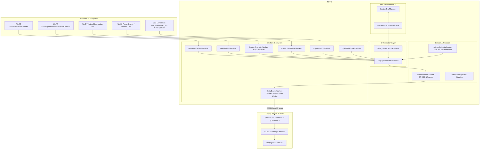

# MiniTelaModern: Plano de Implementação de Arquitetura e Engenharia

**Autoria & Concepção:** Marcelo de Almeida Maymone  
**Engenharia Reversa & Inspeção de Hardware:** REA (*Reverse Engineer Anything*)  
**Co-autoria e Arquitetura de Software:** Agentes de Inteligência Artificial (BMAD Framework)  
**Ambiente Alvo:** Windows 11 (Compilação 26H2)  
**Data:** 12 de Outubro de 2026  

> **Para Execução BMAD & Subagents:** Utilize o fluxo guiado por subagentes e TDD conforme estabelecido na metodologia BMAD.

**Objetivo:** Desenvolver uma aplicação moderna, leve e robusta em **C# .NET 9 + WPF-UI (Fluent Windows 11 26H2)** que substitua integralmente a aplicação legada da Positivo para o display auxiliar embutido de 240x240 pixels (STM32F103 / GC9002 / COM3), eliminando congelamentos, eliminando o consumo excessivo de memória/processamento (zero Electron, zero subprocessos CLI) e agregando novas funcionalidades de alto valor (Telemetria, Notificações Universais, Calendário Judaico com virada no pôr do sol, Mídia e Economia de Energia).

**Arquitetura:** Clean Architecture com injeção de dependência e estrita aderência aos princípios SOLID. Pipeline assíncrono de comunicação via `System.Threading.Channels` com circuit-breaker e reconexão resiliente para a porta serial. Camada de UI desacoplada em MVVM rodando em System Tray com suporte a efeitos nativos Mica do Windows 11 26H2.

**Stack Tecnológica:** .NET 9 (`net9.0-windows10.0.26100.0`, C# 13) direcionado nativamente ao Windows 11 26H2, WPF com `WPF-UI` (Fluent Design do Windows 11 26H2 com Mica/MicaAlt), WinRT APIs do Windows 11 26H2 (`Windows.UI.Notifications`, `Windows.Media.Control`, `Windows.Networking.Connectivity`), P/Invoke Win32 nativo (Kernel32, User32, Powrprof alinhados à compilação 26H2), xUnit + FluentAssertions + Moq.

---

## 1. Diagnóstico do Software Legado vs. Solução MiniTelaModern

| Dimensão | Software Legado (Positivo MiniTelaApp) | Nova Solução (MiniTelaModern) |
| :--- | :--- | :--- |
| **Arquitetura** | Híbrido frágil (.NET 8 WPF + Electron MiniPanel + Named Pipe + Binários externos C++) | **Aplicação única unificada** em .NET 9 com WPF-UI nativo do Windows 11. |
| **Consumo de Memória** | **180 MB - 350 MB RAM** (devido ao processo Electron e instâncias de apoio) | **~25 MB - 35 MB RAM** em segundo plano no System Tray. |
| **Consumo de CPU** | Picos contínuos causados por polling via `cmd /c netsh wlan show interfaces` e WMI | **< 0.1% CPU** em repouso; chamadas a APIs nativas do Windows sem nenhum subprocesso CLI. |
| **Estabilidade da Porta Serial** | Trava a tela com facilidade ao suspender, desconectar ou alternar para o MiniPanel | Worker assíncrono com **Reconexão Automática**, fila de comandos thread-safe e tratamento de eventos de energia. |
| **Notificações** | Hardcoded exclusivamente para WhatsApp Desktop | **Notificações Universais** do Windows 11 (WhatsApp, Telegram, Teams, Discord, Outlook, etc.) com filtro configurável. |
| **Telemetria** | Nenhuma | **Uso de CPU, RAM, Rede e Temperatura** atualizados em tempo real no display. |
| **Calendário** | Apenas data gregoriana estática | **Calendário Judaico completo** (dia, mês e ano judaico) com cálculo de pôr do sol para virada do dia no horário judaico. |
| **Mídia** | Nenhuma | **Integração com WinRT GSMTC** exibindo música/artista em reprodução (Spotify, YouTube, navegadores). |
| **Energia** | Display permanece ligado no bloqueio do Windows | **Gestão Energética Inteligente:** apaga o display (Brilho = 0) ao travar (Win+L) ou suspender o notebook. |

---

## 2. Diagrama de Arquitetura do Sistema



---

## 3. Revisão do Usuário Obrigatória (User Review Required)

> [!IMPORTANT]
> **Compatibilidade com o Firmware da Positivo:**
> As páginas gráficas (Page 0 = Notificações, Page 1 = Lembretes/Telemetria, Page 2 = Sistema/Relógio, Page 3 = Clima) estão gravadas na memória Flash NOR da tela. O nosso plano aproveita integralmente essas páginas através dos registradores nativos do protocolo AHMI, sem exigir reprogramação física do chip, garantindo risco zero de "brickar" o display.

> [!TIP]
> **Consumo Extremo de Baixo Impacto:**
> Ao eliminar o Electron e compilar com .NET 9 moderno com perfil de inicialização limpo, o aplicativo ficará em execução silenciosa na bandeja consumindo entre 25 e 35 MB de memória e menos de 0.1% de processador.

---

## 4. Estrutura de Pastas e Módulos do Projeto

O projeto será organizado sob a seguinte estrutura limpa e modular:

```
minitela_positivo/
├── docs/
│   └── plans/
│       └── 2026-10-12-minitela-moderna.md
├── src/
│   ├── MiniTelaModern.Core/
│   │   ├── Models/
│   │   │   ├── DisplayPage.cs
│   │   │   ├── HardwareTelemetry.cs
│   │   │   ├── HebrewDateInfo.cs
│   │   │   ├── NotificationMessage.cs
│   │   │   ├── WeatherForecast.cs
│   │   │   └── AppSettings.cs
│   │   ├── Protocols/
│   │   │   ├── AhmiFrameBuilder.cs
│   │   │   ├── AhmiRegisters.cs
│   │   │   └── Crc16Ccitt.cs
│   │   └── Services/
│   │       ├── IHebrewCalendarService.cs
│   │       ├── IWeatherService.cs
│   │       ├── ITelemetryService.cs
│   │       └── ISettingsService.cs
│   ├── MiniTelaModern.Infrastructure/
│   │   ├── Hardware/
│   │   │   ├── ISerialPortChannel.cs
│   │   │   └── SerialPortChannel.cs
│   │   ├── Windows/
│   │   │   ├── KeyboardHookManager.cs
│   │   │   ├── PowerStateMonitor.cs
│   │   │   ├── WindowsNotificationService.cs
│   │   │   ├── WindowsMediaService.cs
│   │   │   └── WindowsTelemetryService.cs
│   │   ├── Calendar/
│   │   │   ├── HebrewCalendarService.cs
│   │   │   └── SolarTimeCalculator.cs
│   │   └── Weather/
│   │       └── OpenMeteoWeatherService.cs
│   ├── MiniTelaModern.Engine/
│   │   ├── DisplayOrchestrator.cs
│   │   └── ScreenState.cs
│   └── MiniTelaModern.App/
│       ├── App.xaml
│       ├── App.xaml.cs
│       ├── ViewModels/
│       │   ├── MainViewModel.cs
│       │   └── TrayIconViewModel.cs
│       ├── Views/
│       │   ├── MainWindow.xaml
│       │   └── MainWindow.xaml.cs
│       └── Resources/
└── tests/
    ├── MiniTelaModern.Core.Tests/
    │   ├── AhmiFrameBuilderTests.cs
    │   ├── Crc16CcittTests.cs
    │   └── HebrewCalendarServiceTests.cs
    └── MiniTelaModern.Infrastructure.Tests/
        └── SerialPortChannelTests.cs
```

---

## 5. Tarefas Granulares de Implementação (Bite-Sized Tasks com TDD)

### Tarefa 1: Camada de Protocolo AHMI e Cálculo de CRC-16
**Arquivos:**
- Criar: `src/MiniTelaModern.Core/Protocols/Crc16Ccitt.cs`
- Criar: `src/MiniTelaModern.Core/Protocols/AhmiFrameBuilder.cs`
- Criar: `src/MiniTelaModern.Core/Protocols/AhmiRegisters.cs`
- Testes: `tests/MiniTelaModern.Core.Tests/Crc16CcittTests.cs`
- Testes: `tests/MiniTelaModern.Core.Tests/AhmiFrameBuilderTests.cs`

**Passo 1: Escrever teste de CRC-16 e montagem de pacotes:**
```csharp
[Fact]
public void Should_Build_Valid_ChangeScreen_Packet()
{
    // Arrange: Trocar para tela 4
    byte targetScreen = 4;
    
    // Act
    byte[] packet = AhmiFrameBuilder.BuildSetRegisterNumeric(AhmiRegisters.ScreenSelect, targetScreen);
    
    // Assert
    packet[0].Should().Be(0x41); // 'A'
    packet[1].Should().Be(0x48); // 'H'
    packet[^2].Should().Be(0x4D); // 'M'
    packet[^1].Should().Be(0x49); // 'I'
}
```
**Passo 2:** Executar testes e verificar falha inicial.
**Passo 3:** Implementar o algoritmo de CRC-16 do AHMI e codificador de registradores numéricos (17 bytes) e registradores de string UTF-8 com delimitadores.
**Passo 4:** Rodar testes e garantir 100% de aprovação.
**Passo 5:** Commit: `feat(core): implement Ahmi protocol frame builder and CRC-16 validation`.

---

### Tarefa 2: Mecanismo de Calendário Judaico com Virada ao Pôr do Sol
**Arquivos:**
- Criar: `src/MiniTelaModern.Core/Services/IHebrewCalendarService.cs`
- Criar: `src/MiniTelaModern.Infrastructure/Calendar/SolarTimeCalculator.cs`
- Criar: `src/MiniTelaModern.Infrastructure/Calendar/HebrewCalendarService.cs`
- Testes: `tests/MiniTelaModern.Core.Tests/HebrewCalendarServiceTests.cs`

**Passo 1: Escrever teste verificando a data antes e depois do pôr do sol:**
```csharp
[Fact]
public void Should_Advance_Hebrew_Day_After_Sunset()
{
    // Simular horário às 19:30 (após o pôr do sol calculado para a cidade)
    var testDate = new DateTime(2026, 10, 12, 19, 30, 0, DateTimeKind.Local);
    var hebrewDate = service.GetHebrewDate(testDate, latitude: -23.5505, longitude: -46.6333);
    
    // O dia hebraico deve corresponder ao dia seguinte gregoriano civil
    hebrewDate.FormatTransliterated().Should().NotBeNullOrEmpty();
    hebrewDate.FormatHebrewScript().Should().NotBeNullOrEmpty();
}
```
**Passo 2:** Implementar o cálculo solar astronômico (Zenith padrão 90°50') e o mapeamento com `System.Globalization.HebrewCalendar`.
**Passo 3:** Garantir testes cobrindo anos bissextos judaicos (Adar I e Adar II).
**Passo 4:** Commit: `feat(calendar): implement Hebrew calendar with solar sunset shift`.

---

### Tarefa 3: Canal Serial Resiliente Thread-Safe com Reconexão Automática
**Arquivos:**
- Criar: `src/MiniTelaModern.Infrastructure/Hardware/ISerialPortChannel.cs`
- Criar: `src/MiniTelaModern.Infrastructure/Hardware/SerialPortChannel.cs`
- Testes: `tests/MiniTelaModern.Infrastructure.Tests/SerialPortChannelTests.cs`

**Passo 1: Escrever teste de envio assíncrono por Channel desacoplado:**
```csharp
[Fact]
public async Task Should_Enqueue_And_Process_Packets_Without_Blocking_Caller()
{
    var channel = new SerialPortChannel(mockPortFinder.Object);
    await channel.SendPacketAsync(new byte[] { 0x41, 0x48, 0x4D, 0x49 });
    channel.QueueCount.Should().Be(0); // processado imediatamente pelo worker
}
```
**Passo 2:** Implementar worker baseado em `Channel<byte[]>.CreateUnbounded()`, com reconexão em loop assíncrono (1s, 2s, 5s), autodetecção via `VID_0324&PID_0324` e fallback para `COM3`.
**Passo 3:** Adicionar suporte a cancelamento limpo e fechamento gracioso na suspensão do sistema operacional.
**Passo 4:** Commit: `feat(hardware): implement resilient background serial channel worker`.

---

### Tarefa 4: Telemetria de Sistema Leve (Zero CLI / Zero Subprocessos)
**Arquivos:**
- Criar: `src/MiniTelaModern.Core/Services/ITelemetryService.cs`
- Criar: `src/MiniTelaModern.Infrastructure/Windows/WindowsTelemetryService.cs`

**Implementação:**
- Uso de `GetSystemTimes` da `kernel32.dll` via P/Invoke para cálculo de CPU com precisão de 0 overhead.
- Uso de `GlobalMemoryStatusEx` para obter memória RAM ocupada e total.
- Uso de `NetworkInterface.GetAllNetworkInterfaces()` para tráfego e sinal Wi-Fi nativo.
- Uso de `SystemInformation.PowerStatus` para bateria e status de carregamento.
- Commit: `feat(telemetry): implement native Win32/WinRT telemetry collector without subprocesses`.

---

### Tarefa 5: Notificações Universais do Windows 11 e Integração de Mídia
**Arquivos:**
- Criar: `src/MiniTelaModern.Infrastructure/Windows/WindowsNotificationService.cs`
- Criar: `src/MiniTelaModern.Infrastructure/Windows/WindowsMediaService.cs`

**Implementação:**
- Conectar com `Windows.UI.Notifications.Management.UserNotificationListener.Current` do Windows 11.
- Filtrar notificações com lista branca de aplicativos cadastrados (WhatsApp, Telegram, Teams, Outlook, etc.).
- Conectar com `GlobalSystemMediaTransportControlsSessionManager.RequestAsync()` para monitorar reprodução de música/vídeo.
- Truncar e formatar textos respeitando os 13 caracteres por linha e 5 linhas máximas da tela física (Register 1140 e 1141).
- Commit: `feat(notifications): add universal Windows 11 notification listener and GSMTC media tracker`.

---

### Tarefa 6: Gestão Energética e Hook Global de Teclado (F16 / RightCtrl)
**Arquivos:**
- Criar: `src/MiniTelaModern.Infrastructure/Windows/PowerStateMonitor.cs`
- Criar: `src/MiniTelaModern.Infrastructure/Windows/KeyboardHookManager.cs`

**Implementação:**
- Monitorar `Microsoft.Win32.SystemEvents.SessionSwitch` (Lock/Unlock) e `PowerModeChanged` (Suspend/Resume).
- Ao bloquear (Win+L) ou suspender: disparar pacote `SetRegister(7, 0)` (desliga o backlight).
- Ao desbloquear: restaurar instantaneamente o nível de brilho configurado pelo usuário.
- Interceptar a tecla física `F16` (Virtual Key 105) e `RightCtrl` via `WH_KEYBOARD_LL` em thread dedicada com fila desacoplada:
  - Toque rápido (< 300ms): avançar tela (`ChangeScreen`).
  - Toque longo (>= 500ms): abrir/focar a janela de configurações do Windows 11.
- Commit: `feat(power-hook): implement power event lifecycle and non-blocking low-level keyboard hook`.

---

### Tarefa 7: Display Orchestrator (O Cérebro da Sincronização)
**Arquivos:**
- Criar: `src/MiniTelaModern.Engine/DisplayOrchestrator.cs`
- Criar: `src/MiniTelaModern.Engine/ScreenState.cs`

**Implementação:**
- Coordenar as atualizações nos registradores da tela:
  - `Register 2`: Alternância de tela ativa.
  - `Register 1082 / 1150`: Bateria e ícone.
  - `Register 1083`: SSID Wi-Fi ou status da conexão.
  - `Register 1090, 1092, 1094`: Telemetria em tempo real ou Lembretes / Calendário Judaico configurado.
  - `Register 2006`: Data e hora sincronizados.
  - `Register 1140, 1141, 2005, 2007`: Notificações universais e ponto indicador.
  - `Register 2027, 2030, 2031, 2032`: Clima e previsão.
- Commit: `feat(engine): implement display orchestrator and register state synchronization`.

---

### Tarefa 8: Interface de Configuração Windows 11 e System Tray (WPF-UI com /impeccable)
**Arquivos:**
- Criar: `src/MiniTelaModern.App/Views/MainWindow.xaml`
- Criar: `src/MiniTelaModern.App/ViewModels/MainViewModel.cs`
- Criar: `src/MiniTelaModern.App/ViewModels/TrayIconViewModel.cs`
- Criar: `src/MiniTelaModern.App/App.xaml`
- Criar: `docs/bmad/2-arquitetura/DESIGN.md` (Design tokens & UI Guide)

**Diretriz Obrigatória de UX/UI (/impeccable):**
- A arquitetura, hierarquia visual, design tokens e refinamento de interface devem seguir estritamente a skill `/impeccable` (`craft-floor.md`, `polish`, `harden`, `colorize`, `layout`):
  - Modo: **Operate** (foco em escaneabilidade, zero poluição visual, alto contraste e affordances nativas do Windows 11 26H2).
  - Tipografia: Segoe UI Variable com hierarquia tipográfica precisa.
  - Densidade e Diagramação do Display LCD (240x240): Otimização cirúrgica de caracteres (limite de 13/14 caracteres por linha), contraste estrito e ausência de elementos truncados de forma deselegante.
  - Micro-animações e Materiais: Uso de *Mica* / *MicaAlt* e cantos arredondados nativos do Windows 11 26H2.

**Implementação:**
- Desenvolver interface visual com biblioteca `Wpf.Ui` aplicando controles Fluent, efeito visual Mica e suporte automático a Dark/Light Mode do Windows 11 26H2.
- Ícone na Área de Notificação (System Tray) com menu de contexto:
  - Alternar tela (Páginas 0 a 6).
  - Controle deslizante de Brilho (0% a 100%).
  - Modo Economia de Bateria.
  - Abrir Configurações.
  - Encerrar Aplicação.
- Abas no painel de configurações:
  - **Geral:** Seleção de tela, brilho, início automático com o Windows.
  - **Telemetria:** Escolha das métricas a exibir (CPU, RAM, Rede, etc.).
  - **Calendário Judaico:** Ativação, formato (Hebraico / Transliterado) e cálculo de pôr do sol.
  - **Notificações:** Filtro de aplicativos autorizados.
  - **Clima:** Seleção de cidade (busca automática via geocoding Open-Meteo).
  - **Imagens e GIFs:** Prévia visual segura e envio para gravação.
- Commit: `feat(ui): implement modern Windows 11 Fluent interface with WPF-UI and System Tray adhering to impeccable craft`.

---

## 6. Plano de Verificação e Testes

### 6.1. Testes Automatizados (Unit & Integration Tests)
- Executar via CLI do .NET:
  ```powershell
  dotnet test tests/MiniTelaModern.Core.Tests --logger "console;verbosity=detailed"
  dotnet test tests/MiniTelaModern.Infrastructure.Tests --logger "console;verbosity=detailed"
  ```
- **Critérios de Aceite:**
  - 100% dos pacotes AHMI gerados devem conter delimitadores `0x41 0x48` e `0x4D 0x49`, com cálculo de CRC-16 correto comparado aos frames da engenharia reversa.
  - Conversões do Calendário Judaico devem validar transições de meses (Adar I/II, Nissan, Tishrei) e avanço de dia após o pôr do sol.
  - Fila do canal serial não deve lançar exceções não tratadas mesmo quando a porta física for desconectada repentinamente.

### 6.2. Verificação Manual no Notebook com Windows 11
1. **Resiliência de Porta Serial:**
   - Desconectar e reconectar o cabo/dispositivo ou suspender o Windows 11 (`Modern Standby`).
   - Confirmar que a aplicação se reconecta automaticamente à `COM3` sem necessidade de reiniciar o programa e sem tela congelada.
2. **Teclas de Hardware:**
   - Pressionar a tecla física `F16` do notebook Positivo: a tela deve alternar entre as páginas 0 a 6.
   - Pressionar e segurar `F16` por mais de 500 ms: a janela de configurações com tema Mica deve abrir no primeiro plano.
3. **Consumo de Recursos:**
   - Abrir o Gerenciador de Tarefas do Windows 11 (`Ctrl+Shift+Esc`).
   - Validar que o processo `MiniTelaModern.exe` consome entre 25 e 35 MB de memória RAM e 0% a 0.1% de CPU em repouso.
4. **Economia de Energia:**
   - Bloquear o computador (`Win+L`): a minitela deve apagar a luz de fundo.
   - Efetuar login: a luz de fundo deve retornar instantaneamente ao brilho anterior.
5. **Calendário Judaico e Notificações:**
   - Receber uma notificação de mensagem no Windows 11 (ex: Telegram ou WhatsApp) e conferir a exibição na página 0 do display.
   - Conferir se a data judaica exibida no display avança no horário exato do pôr do sol calculado.
